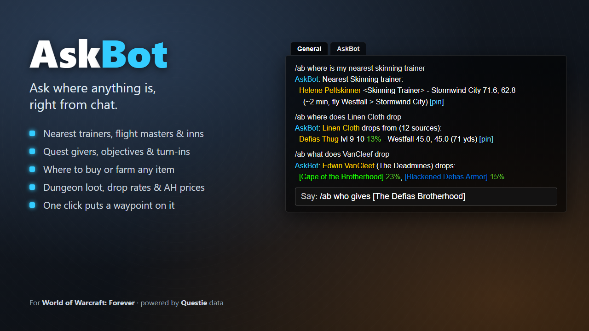

# AskBot



**Ask where anything is, right from chat.**

AskBot answers the questions you'd normally alt-tab to a database site for, without leaving the game. Type a question, get the nearest answer for *your* character, and click once to put a waypoint on it.

```
/ab where is my nearest skinning trainer
AskBot: Nearest Skinning trainer:
  Helene Peltskinner <Skinning Trainer> - Stormwind City 71.6, 62.8 (~2 min, fly Westfall > Stormwind City) [pin]
```

Built for **World of Warcraft: Forever**.

---

## What you can ask

### Levelling helper
- `/ab where should I quest next?`: the best zones for you right now, then the nearest quest givers.
- `/ab quickest route to Loch Modan` (or `how do I get to`, `fastest way to`, `directions to`): the quickest way to the zone's flight master (else its inn or a quest giver there), using your hearthstone, known flight paths, boats and zeppelins.
- `/ab where should I level` (or `which region should I level in`, `best place to level`, `/ab zones for level 25`, `/ab where should I go at 24`): the zones with the most XP from quests *you* can still take within two levels of yours (plus the ones in your log), with the XP total, each with the quest giver to head for and, for zones you're not in, the flight path in its busiest town (marked "not learned" if you don't have it). Worked out from Questie's data and your own progress, not a fixed levelling guide. Town names appear once you've opened a flight map that shows them.
- `/ab what should I do?` (or `what's next`, `what now`): one line each for your nearest hand-in, your nearest objective, the nearest new quests, a better zone if you're not in it, and a dungeon for your level.
- `/ab my quests`: everything in your quest log that's ready to hand in, then the nearest unfinished objectives across all your quests.
- `/ab hand in route`: every quest that's ready to hand in, as a route that always goes to the nearest stop next.
- `/ab which quests should I abandon` (or `/ab tidy quest log`): grey quests, quests that need a group (elite, dungeon) and quests whose next step is far away.
- `/ab best quests` (or `which quests give the most xp`): the quests in your log and the nearest ones you can pick up, ranked by XP per minute. The XP is Questie's real Forever figure for your level. The minutes are a rough estimate: travel to the quest giver, the objectives (kills, items that drop, things to click, what you've already done) and the walk back. Quests well above your level are left out.
- `/ab quests near The Grizzled Den` (or `what else can I do near …`): other quests whose objectives are in the same spot, ones to pick up (with their XP and a pin on the giver) and ones already in your log. Asking who gives a quest also adds a "Same area:" line, so you can grab them together.
- `/ab what quests take me to Ironforge` (or `quests that go to …`): quests in your log and ones you can pick up whose turn-in, or the nearest place to do an objective, is in that zone, plus a "Coming up" line for ones that open within two levels or after an earlier quest.
- `/ab kill only quests here` (or `kill quests`): quests in the zone you're in whose only objectives are killing mobs, nearest giver first, plus the ones in your log with mobs here. `/ab kill and loot quests` adds quests where you bring items that only mobs drop.
- `/ab what reagent quests are in my level range` (or `reagent quests`, `ah quests`): quests in your log and ones you can pick up whose only objectives are items that mobs drop, at least some of them crafting reagents you can buy on the auction house instead. Each shows how many of each item to buy (after what's in your bags and bank), anything you still have to farm, the cost and where to hand it in: your log first, then best XP per gold *(prices with Auctionator)*. It ends with one shopping list for all of them, each item's count added up, with the total. Add `log` (`ah quests in my log`) to list only quests you already have.
- `/ab cost to complete [quest]` (shift-click the quest, or type its name): what's left to buy for a quest's items, the price of each, the total, and where to get and hand in the quest.
- `/ab quests here`: quests you can pick up, nearest first, grouped by who gives them and coloured by difficulty, with their XP. AskBot uses Questie's own checks, so completed quests, missing prerequisites, quests for other classes and grey quests are all left out.
- `/ab dungeons` (or `/ab dungeons for level 25`): dungeons that suit your level, with entrance pins and a link to their loot *(with AtlasLoot)*.
- `/ab what do I need before Deadmines` (or `/ab SFK quests`, `/ab prep for Gnomeregan`): the dungeon's entrance and the quests to pick up before you go, grouped by quest giver. Quests for later levels, quests that aren't available yet (with links explaining why) and the dungeon's quests your group already has are listed too. Class quests with an objective inside count. Short names such as VC, SFK, BFD, RFK and ZF work.
- `/ab rares`: the nearest rare and rare-elite mobs, with their levels.
- `/ab what skills can I learn` (or `what can I train`, `spells I can learn`, `skills available`): class spells ready to train at your level with the total cost, a pin on the nearest class trainer, and what comes at your next training level. AskBot reads the list from your class trainer's window, so open it once first; spells you learn are ticked off.

### Where's the nearest...?
Profession and class trainers, weapon masters, pet trainers, flight masters, innkeepers, bankers, auctioneers, stable masters, repair vendors and any vendor. Only NPCs friendly to your faction are shown.

- `/ab where is my nearest skinning trainer`
- `/ab nearest fp`
- `/ab where's my class trainer`
- `/ab closest inn`
- `/ab where is my nearest vendor` (or `merchant`)
- `/ab what weapon master teaches bows` (or `where do I learn daggers`, `weapon master for 2h swords`): only the weapon masters who teach it. `/ab nearest weapon master` lists what each one teaches. AskBot starts from Classic's lists and remembers what a weapon master's training window shows.

### Quests
Shift-click a quest into the command, or type its name.

- **A quest in your log:** the nearest place for each objective you haven't finished, then where to hand it in.
- **A quest you don't have:** who gives it, with its level and XP, and other quests whose objectives are in the same spot.
- **Gaps in Questie's data are filled in:** mobs inside dungeons point to the entrance, quest items you've lost point to whoever hands them out, and class quests get community locations where Questie has none, e.g. the Moonkin Stone for the druid bear form, the warlock summoning circles, and Forever's new shaman Call of Water spots. These are marked *(community info)*.

**Quest chains:** when a quest you expect isn't showing up, it's usually waiting on an earlier one.
- `/ab what do I need before [quest]` (or `how do I unlock`, `why can't I get`, `[quest] prereqs`) lists the earlier quests you haven't done, in order, with where to pick up the first one. It also mentions optional lead-in quests.
- `/ab what comes after [quest]` lists what a quest leads to, and whether you can take it yet.

**Reputation:** `/ab quests for Stormwind rep` (or `Argent Dawn rep quests`, `how do I get rep with Timbermaw`) shows your standing, the faction's quests in your log, the nearest givers of ones you can take now with how much reputation each gives, and ones for later levels. Short names such as SW, IF, Org, UC, TB and AD work.

**Items that start quests:** `/ab quest starters` lists quest-starting items in your bags, then ones that drop near you for quests at your level. Asking about an item that starts a quest says so.

Examples:
- `/ab [The Defias Brotherhood]`
- `/ab who gives Bounty on Murlocs`
- `/ab turn in [Hilary's Necklace]`

### Items
Vendors that sell it, mobs and objects that drop it, quests that reward it, and items that contain it.

- `/ab where can I buy Coarse Thread`
- `/ab where does Linen Cloth drop`
- `/ab where can I get [shift-clicked item]`
- `/ab [shift-clicked item]` on its own does the same, and for gear also says whether it's an upgrade.
- `/ab target`: asks about whatever you have targeted.

### Gear upgrades
AskBot compares what you're wearing with gear you can get soon: rewards from quests in your log or that you can take within two levels, dungeon drops near your level *(with AtlasLoot)*, and gear on the auction house *(with Auctionator)*. It shows the best upgrade for each slot and where to get it.

- `/ab upgrades` (or `what gear should I get`, `better weapon`, `upgrades legs`, `upgrade daggers`: a weapon type such as daggers, swords, axes, maces, staves, bows or wands)
- `/ab what boss drops are good for me` (or `upgrades from dungeons`, `upgrades from quests`, `AH upgrades`): one kind of source only. The dungeon version also ranks dungeons by how many upgrades they hold.
- **Your spec** comes from your talents. Before you've spent any (or when two trees are close), AskBot uses a common levelling spec and says so, e.g. *for Warrior (no talents yet, scored as Arms)*. Name a spec to override it: `/ab upgrades as tank`, `I'm a feral druid, what gear should I go for`.
- **Not usable yet?** Items you'll be able to use within two levels are still listed, marked e.g. *(at 26)*, *(Plate Mail at 40)* or *(train Two-Handed Axes)* with a link to the nearest weapon master.
- `/ab is [item] an upgrade?` (or `is Militia Leggings better`, `should I use [item]`, `[item] upgrade as tank`): one item against what you're wearing, e.g. *+35% over [Worn Leggings]*, or why your class can't use it.
- `/ab anything in my bags an upgrade?` (or `any upgrades in my bags`, `bag upgrades as tank`): every piece of gear in your bags that beats what you're wearing, biggest gain first.
- **Junk selling:** when you open a merchant, AskBot sells grey items, weapons and armour your class can't use or has outgrown (5+ levels below you and not an upgrade for any of your specs), and food and drink 10+ levels below you, bound or not. It keeps anything the AH pays clearly more for (1.5x the vendor price and 1s more, after the 5% cut) and lists it, keeps greens and blues with no AH price yet, and never sells profession tools, fishing poles, potions, quest items or epics. The first 12 sell straight away (all buyable back); a [sell] link in chat sells the next 12.
- **Rare alerts:** when you enter a zone, AskBot says if a rare mob near your level there can drop an upgrade for you, with a pin. Turn it off in `/ab options`.
- Items are scored with simple stat weights per spec, so treat the list as a guide. Bonuses that only appear as "Equip:" lines (spell damage, attack power, hit, crit, mana regen) are read from the item's tooltip. `/ab debug item [item]` shows an item's stats and score.

### Mining, herbs and fishing schools
The nearest node, the zones with the most nodes, and whether your skill is high enough (coloured like the game's skill-up colours).

- `/ab where can I mine copper` (or `/ab copper ore`, `/ab tin nodes`); add a zone to stay in it: `/ab tin loch modan`, `/ab copper in elwynn`
- `/ab Peacebloom` (or `/ab where can I pick Kingsblood`)
- `/ab where should I mine` / `/ab where should I level herbalism`: the best node for your current skill, and what opens up next.

### Professions
With **AtlasLoot** installed, AskBot knows every recipe: what it makes, its reagents, the skill it's orange, yellow, green and grey at, and the pattern, plan or formula that teaches it. Without AtlasLoot, open each profession window once so AskBot can read the recipes you know. Either way, opening the window tells AskBot which recipes you've already learned.

- `/ab recipe for Linen Bag` (or `how do I learn …`, `pattern for …`, `where do I get the plans for …`): where to get the pattern, plan, formula or recipe: vendors, drops and quests, with pins. If no recipe item teaches it, a trainer does.
- `/ab mats for 5 Linen Bag` (or `what do I need to make …`, `shopping list for …`): each reagent with how many you have and how many to buy, vendor or AH prices *(with Auctionator)*, the total, and whether crafting beats buying the item.
- `/ab how do I level tailoring` (or `plan [Tailoring]`, `tailoring skill ups`, `cheapest leveling [Tailoring]`, `what should I craft`): the orange and yellow recipes at your skill, cheapest per skill point first (mats at full price, even ones in your bags; yellow recipes by their chance of a skill-up, shown as a %; trainer recipes you haven't learned, with the training cost once you've opened that profession's trainer; patterns to find last), then a plan to your skill cap (recipes by skill range, what to buy, and which mats you hold are worth selling instead, after the AH's 5% cut), when the trainer has new recipes, and a nudge at your skill cap. Mining and herbalism suggest the best nodes for your skill.
- `/ab [Tailoring] for profit` (or `most profitable tailoring`, `tailoring profit`): the crafts you know, or a trainer teaches at your skill, whose output sells for more than its mats cost to buy: AH price less the 5% cut (or a vendor's price if higher), with the profit each, whether it's still a skill-up, and a [list] of mats. Needs Auctionator prices. `/ab cost to craft [Linen Bag]` (or `how much to craft X`, `X crafting cost`) is the mats list with prices; add `from scratch` (or `ignoring bags`, `buying everything`) to price every mat as bought, ignoring what you hold. `/ab when can I learn [Iron Shield Spike]` (or `what skill for X`) says the skill a recipe needs (your trainer's figure once seen), how far you are, and where to learn it. `/ab level [Tailoring] with profit` (or `... profitably`) is the skill-up list and plan with each craft's sale price taken off its cost, so crafts that sell well rank first and the plan says what selling everything you make brings back.
- **Skinning:** the highest level you can skin, and the zones with the most beasts in your skill-up range, with pins. Beasts are recognised by name and corrected by what the game tells AskBot about mobs you target or mouse over.

### Dungeon loot and drop rates *(with AtlasLoot)*
What a boss drops, with drop rates, plus a pin on the dungeon entrance.

- `/ab what does VanCleef drop`
- `/ab Deadmines loot`

### Prices *(with Auctionator)*
The auction house price, how old that price is, and what vendors pay.

- `/ab price of Linen Cloth`
- `/ab how much is [item] worth`

Ask at the auction house and AskBot checks the live price for you. Away from it, you get the price from Auctionator's last scan. AskBot also keeps a list of the items you've asked about: `/ab refresh prices` re-checks them all, straight away at the auction house or automatically the next time you open it, and tells you what changed.

With **AHDB** (Auction House DataBase) installed too, AskBot uses its price history so one overpriced listing can't fool you: anything you'd sell (profit lists, "sells for", junk to the AH) is valued at the lower of the latest price and the usual one (the 30-day median of each day's lowest price, once AHDB has seen it on 3 days), prices show `usually X`, mats you'd buy during a spike are flagged `usually X`, and `only N listed` warns when one or two listings set the price. AskBot takes whichever is newer of Auctionator's price and AHDB's last full scan, so you can turn off Auctionator's autoscan (its scan and AHDB's get in each other's way).

### NPCs by name
- `/ab where is Gryan Stoutmantle`

### Your group
- `/ab where is my party` (or `where is everyone`): where each group member is, nearest first, with travel time and a pin.
- `/ab where is Buddy`: one group member. For a guild member outside your group, the zone they're in (the game only gives addons exact positions for group members).
- Friends can ask too: `!ask where is my party member` answers from where *they* are.
- `/ab who has Red Linen Goods` (or `who needs …`): your progress and each group member's on a quest. Quest answers also add a "Group:" line when someone in your group has the quest. This uses Questie's party sync, so it only covers members who run Questie.

You don't have to type names exactly. Lower case, missing apostrophes and partial names all work. When AskBot isn't sure what you meant, it offers clickable "Did you mean" suggestions.

---

## Nearest means quickest

Answers are ranked by estimated travel time, not straight-line distance. AskBot compares walking (mounted from level 40) with flight paths, boats and zeppelins, and spells out the route when it isn't just a walk:

```
Jannok Breezesong - Teldrassil 56.0, 60.0 (~10 min, fly Westfall > Stormwind City,
  boat Stormwind Harbor > Auberdine, boat Auberdine > Rut'theran Village) [pin]
```

Open any flight master's map once and AskBot learns which flight paths your character knows, so it only plans routes you can actually take.

**Your hearthstone counts too.** Use it once (or set it at an inn) and AskBot learns where it goes. While it's off cooldown, any answer where hearthing saves a minute or more says so: *(~1 min, hearth to Auberdine)*. `/ab hearth` shows where it's set and when it's ready.

## Waypoints

Every answer has a **[pin]** link. The best answer is pinned automatically (you can turn that off), and you can click any other one. With **TomTom** installed you get its arrow; without it, AskBot uses the game's own map pin. `/ab clear` removes the pin.

**Everything at once:** put `show all` in front of a question (`/ab show all skinning trainers`, `/ab show all Copper Vein`, `/ab show all rares`) to put an icon on your world map and minimap for every place it finds, up to 200. Hover an icon for its name, click it to pin it; `/ab clear` removes them all.

## Let friends ask too

Friends don't need AskBot themselves. Switch sharing on (`/ab share guild on`, or `party` / `whisper`) and anyone can type in guild or party chat:

```
!ask where's the nearest flight master
[AskBot] Nearest Flight master:
Thor <Gryphon Master> - Westfall 56.6, 52.6 (71 yds, <1 min)
```

- **Where they are:** answers are worked out from the asker's position (exact for group members, their zone for guild members) and their class, so "my class trainer" means *their* class.
- **Pins for them too:** each answer carries the game's own `[Map Pin Location]` link, which anyone can click to put the spot on their map, no addon needed.
- **No spam:** it's off by default, answers are at most four lines, and there's a cooldown per person.
- **Several AskBots:** when more than one guild member runs AskBot, only one of them answers.
- **Questions about your own character:** "what should I do", "my quests", "hand in route", "tidy quest log", "quests here", "best quests", "quests near …", "quests that take me to …", gear upgrades, bag upgrades, skills to train, mats lists, profession skill-up plans and your hearthstone need the asker's own quest log, gear, bags or trainer list, so they only work with `/ab`.

## Settings

`/ab options` opens AskBot's page in the game's Settings, under AddOns:
- whether to pin the best answer automatically
- how many results to list (1-5)
- rare alerts when you enter a zone
- selling junk at merchants, and whether gear for your other specs counts as junk
- which chats friends can `!ask` in

---

## Requirements

| Addon | Required? | What it adds |
|---|---|---|
| **Questie** (with QuestieDB) | **Required** | All NPC, quest and item locations |
| TomTom | Optional | Waypoint arrow |
| AtlasLoot (Forever) | Optional | Boss loot tables, drop rates, dungeon gear |
| Auctionator | Optional | Auction house prices |
| AHDB (Auction House DataBase) | Optional | Price history: usual prices, spike and low-supply warnings |

## Commands

| Command | Does |
|---|---|
| `/askbot <question>` (also `/ab`, `/ask`) | Ask a question |
| `/ab help` | Example questions |
| `/ab clear` | Remove the waypoint and any "show all" map icons |
| `/ab again` | Ask your last question again |
| `/ab history` | Your recent questions, as links |
| `/ab hearth` | Where your hearthstone goes and when it's ready |
| `/ab status` | What AskBot has loaded |
| `/ab forget flights` | Forget learned flight paths |
| `/ab refresh prices` | Re-check the prices you've asked about (needs Auctionator) |
| `/ab forget prices` | Clear that price list |
| `/ab options` | Settings |
| `/ab share` | Who can ask with `!ask` (`/ab share guild on`, `party`, `whisper`; `on`/`off`) |

AskBot answers in whichever chat tab you type in, so you can give it a tab of its own.

---

## How it works, and its limits

- **No internet, no AI.** WoW addons can't go online, so AskBot reads the data your other addons already have: Questie's database for locations and quests, AtlasLoot for loot, Auctionator for prices. When those addons update, AskBot's answers improve with them.
- **Questions are matched by keywords.** AskBot understands the kinds of questions listed above, not anything you can type.
- **Travel times are estimates.** AskBot doesn't know about mountains or water in the way, and uses average waiting times for boats and zeppelins.
- **Drop rates** come from AtlasLoot and mostly cover dungeon and raid drops. Prices are only as fresh as your last Auctionator or AHDB scan.
- **Gaps in Questie's data.** A few quest items aren't placed by Questie (for example the Trial of the Sea Lion pendant halves). AskBot fills known gaps from public sources, marked *(community info)*, in `KnownLocations.lua`. If you find another, `/ab debug quest [quest link]` shows what Questie has for it. Open an issue with that output and the right location, and it can be added.

## Credits

AskBot stands on the shoulders of **Questie** and **QuestieDB** (data), **HereBeDragons** (map maths), **TomTom**, **AtlasLoot** and **Auctionator**. Thanks to their authors.

## License

AskBot is free software under the **GNU General Public License v3** (or later); see `LICENSE.md`.

*AskBot is a fan-made addon and is not affiliated with or endorsed by Blizzard Entertainment.*
